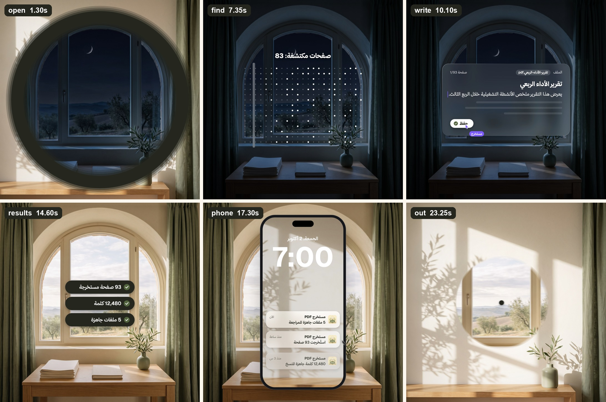

# period-launch-video

> مهارة لـ Claude Code تصنع فيديو إطلاق مربّعًا مدته 24 ثانية، تجري أحداثه كلها **داخل نقطة اسم المنتج**.
> A Claude Code skill that makes a 24-second square launch video that happens entirely **inside the period of your wordmark**.



## العربية

النقطة تنفتح كالقزحية على مشهد ليلي، ثم تتشكّل واجهات زجاجية بأسلوب iOS دون أي قطع: طلب ← بحث ← كتابة ← الليل ← النتائج ← شاشة قفل الجوال ← الإثبات ← زر الدعوة. بعدها تُغلق القزحية على النقطة، فيعود الاسم وبجانبه أيقونة التطبيق، ويطابق الإطار الأخير الأول فيعيد الفيديو نفسه بلا قطع.

- **الصورة:** ‏1440×1440 بمعدل 60fps، ورندر بأربعة إطارات فرعية لضبابية الحركة.
- **المحرّك:** لوحة canvas واحدة، وكل إطار دالة نقية `seek(t)`.
- **المحتوى:** كله في ملف واحد `config.js` (النصوص والأرقام والألوان)، والتوقيت كله في جدول واحد.
- **الصوت:** المؤثرات موضوعة على ذروتها المقاسة، والأغنية تدخل على ضربتها، والمستوى ‎−14 LUFS.
- **الفحص:** كل إطار يُفحص آليًا بحثًا عن القفزات.
- **الصور الأربع** (ليل وفجر ونهار متطابقة، وصورة مشمسة للخارج) تأتي من Higgsfield، أو من Codex CLI عبر اشتراك ChatGPT، أو من برومبتات جاهزة تلصقها في Gemini أو ChatGPT.

### التثبيت
```bash
git clone https://github.com/TurkiHassan/period-launch-video ~/.claude/skills/period-launch-video
```
ثم اطلب من Claude Code: «سوّ فيديو إطلاق داخل النقطة لمشروعي».

**المتطلبات:** ‏macOS (منه يُنسخ مؤشر النظام الحقيقي محليًا)، وNode 18+، وPython 3 مع `numpy` و`Pillow`، و`ffmpeg`.
**اختياري:** خادم Higgsfield MCP، أو `codex` CLI مسجّل الدخول بحساب ChatGPT.

## English

The period opens like an iris onto a night photo. iOS-style glass UI then morphs without a single cut: ask → find → write → night → results → phone lock screen → proof → CTA. Finally the iris closes back into the period beside your app icon, and the last frame equals the first.

- **Video:** 1440×1440 at 60fps, with 4 motion-blur subframes.
- **Renderer:** one canvas, where every frame is a pure `seek(t)` rendered by Playwright.
- **Content:** all text, numbers and colours live in `template/config.js`, and all timing in one beat table.
- **Sound:** peak-aligned SFX, the song entering on its hit, loudness-normalised to −14 LUFS.
- **Checks:** an automatic scan of every frame for single-frame jumps.
- **Photos:** the four plates come from Higgsfield MCP, the local Codex CLI (`image_gen` on a ChatGPT plan), or ready-made prompts for Gemini/ChatGPT. See `references/image-prompts.md`.

**Install:** clone into `~/.claude/skills/period-launch-video`, then ask Claude Code for "a launch video inside the period of my wordmark".
**Requires:** macOS (the real system pointer is copied locally at setup), Node 18+, Python 3 with numpy and Pillow, and ffmpeg.

The template is built right-to-left for Arabic. For an LTR product, see the notes at the end of `SKILL.md`.

## Layout
```
SKILL.md                    workflow Claude follows
references/craft.md         direction, beat map, solved gotchas
references/image-prompts.md how to get the 4 aligned photos (3 routes)
scripts/new_project.sh      copy template into a project + setup
scripts/codex_image.sh      generate/edit an image through the local Codex CLI
template/                   index.html + config.js + render/scan/audio/build scripts + assets
```

## Credits
- **Geist** (Vercel): SIL OFL 1.1, see `template/assets/fonts/OFL-Geist.txt`
- **IBM Plex Sans Arabic** (IBM): SIL OFL 1.1, see `template/assets/fonts/OFL-IBMPlexSansArabic.txt`
- **UI SFX:** [Kenney](https://kenney.nl), CC0. **Keyboard sounds:** [Keyboard Soundpack #1](https://opengameart.org/content/keyboard-soundpack-1-typing-and-single-keystrokes) by unicae_games, CC0
- **Not included:** the macOS pointer (copied from your own Mac at setup), Thmanyah fonts (add them yourself if licensed), music and photos (yours per project)
- The example `config.js` is the launch video of [مستخرج PDF](https://pdfreader-alpha.vercel.app).
